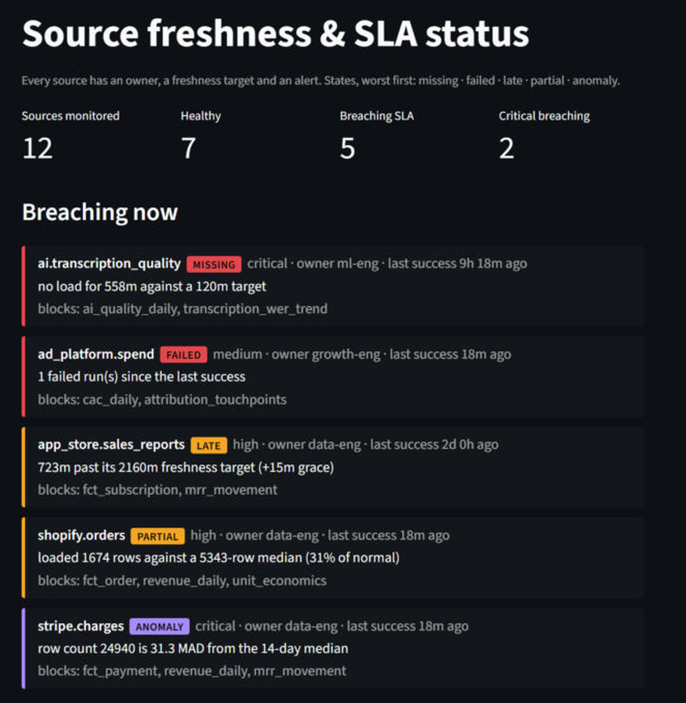

# Source Freshness & SLA Observability

Every source has an owner, a freshness target and an alert — and nothing goes
stale for weeks unnoticed.

Most data monitoring tells you a *job* failed. The expensive failure is quieter:
a load that arrived but arrived late, or arrived with a third of its rows, and
fed a dashboard that nobody doubted. This is a small platform that watches the
**data** rather than the services: a per-source registry, five failure states,
severity-tiered alerts, and a status page that says who owns the breakage and
what it blocks downstream.

Built around the sources a consumer-hardware subscription business actually
runs on: an app database over CDC, Stripe, Shopify, Amazon settlements, App
Store sales reports, an ad platform, and the AI evaluation jobs behind
transcription, summarization, speaker mapping and assistant answers.



## What it does

| State | Meaning | How it is decided |
|---|---|---|
| `missing` | the source stopped arriving | last success older than 3× its deadline, or no success on record |
| `failed` | a run errored after the last good load | a failed load event newer than the last success |
| `late` | arrived, but past its freshness target | age > target + grace |
| `partial` | arrived thin — truncated pull, dropped page | rows < 60% of the 14-day median |
| `anomaly` | volume moved without an obvious break | robust z-score (MAD) over the 14-day median > 4.0 |

Precedence is deliberate: `missing` outranks `partial`, because a source that
stopped loading must never be reported as merely thin. Volume checks use median
absolute deviation rather than standard deviation, so a single bad day does not
widen the band enough to hide the next one.

Restating sources (Amazon settlements, App Store reports, ad spend) carry
deliberately long targets — they land late and then revise for a day or two,
and a monitor that pages on that gets muted within a week.

## Run it

Offline, no server needed:

```bash
pip install -r requirements.txt
python -m obs.cli --offline seed         # 21 days of history, with faults planted
python -m obs.cli --offline ingest-jira  # land a Jira batch from the fixture
python -m obs.cli --offline check        # evaluate, record, alert
OBS_BACKEND=offline streamlit run app/status_app.py
```

On Windows PowerShell, use `;` instead of `&&` and run each step on its own line:

```powershell
Expand-Archive .\freshness-sla-observability.zip -DestinationPath . -Force
cd .\freshness-sla-observability
python -m pip install -r requirements.txt
python -m obs.cli --offline seed
python -m obs.cli --offline check
$env:OBS_BACKEND = "offline"
python -m streamlit run app/status_app.py   # `streamlit` alone needs the user Scripts dir on PATH
```

Against ClickHouse:

```bash
docker compose up -d
python -m obs.cli migrate
python -m obs.cli seed                # swap for your real load-event feed
python -m obs.cli check --fail-on-alert
streamlit run app/status_app.py
```

Sample output:

```
[MISSING] ai.transcription_quality (critical) owner=ml-eng -> page
    no load for 540m against a 120m target
    blocks: ai_quality_daily, transcription_wer_trend
[LATE]    app_store.sales_reports (high) owner=data-eng -> notify
    705m past its 2160m freshness target (+15m grace)
    blocks: fct_subscription, mrr_movement
[PARTIAL] shopify.orders (high) owner=data-eng -> notify
    loaded 1674 rows against a 5343-row median (31% of normal)
    blocks: fct_order, revenue_daily, unit_economics
[ANOMALY] stripe.charges (critical) owner=data-eng -> notify
    row count 24940 is 31.3 MAD from the 14-day median
    blocks: fct_payment, revenue_daily, mrr_movement

7/12 sources healthy, 5 alert(s)
```

## The registry is the contract

`registry/sources.yml` is the living data guide. A source without an owner, a
cadence and a freshness target fails validation, and a source that lands in the
warehouse without an entry fails `obs registry-audit` — which runs in CI, so
new pipelines cannot quietly arrive unwatched.

```yaml
- name: stripe.charges
  domain: revenue
  owner: data-eng
  system: stripe_api
  cadence: 1h
  freshness_target_minutes: 180
  severity: critical
  downstream: [fct_payment, revenue_daily, mrr_movement]
```

A target tighter than its own cadence is rejected at load time, because a
target that can never pass is the most common way monitoring becomes noise.

## Non-platform sources: Jira

Platform data arrives through CDC and vendor APIs the warehouse already knows
how to land. Enterprise applications do not — each has its own auth, its own
pagination, its own idea of a timestamp, and administrators who add fields
without telling anyone. `obs/sources/` handles those four facts so an
enterprise app lands on the same terms as everything else in the registry.

```bash
python -m obs.cli --offline ingest-jira          # reads fixtures/jira_issues.json
JIRA_BASE_URL=... JIRA_EMAIL=... JIRA_API_TOKEN=... \
  python -m obs.cli ingest-jira --project DATA   # live, incremental
```

One pull produces three data products at three grains: `jira.issues` (one row
per issue, current state), `jira.changelog` (one row per field transition) and
`jira.worklogs` (one row per logged entry). Each lands a load event, so a
stalled connector shows up on the status page next to a late Stripe pull with
the same severity rules and the same owner on the hook.

**Incremental, with a rewind.** Pulls run `updated >= watermark` against a
stored high-water mark. The watermark rewinds 30 minutes on every run, because
Jira issues and worklogs are edited retroactively — without the rewind, a late
edit lands inside a window that has already been pulled and is never seen
again. Re-ingesting a window is safe: rows are deduplicated on the primary key,
last write wins.

**Schema drift is classified, not feared.** A declared contract names the
fields downstream models depend on, their types, and which may never be null.
Before anything lands, the batch is checked against it:

| Drift | Response |
|---|---|
| a new `customfield_*` | lands in `custom_fields`; promoted to a column when someone models it |
| a new plain field | recorded in the drift report, load proceeds |
| a declared field missing | fatal if required — models break either way, so fail at ingestion where it is cheap |
| a declared field retyped | always fatal — this is the one that corrupts marts without failing a load |

Nothing in `contract.py` is Jira-specific. Onboarding the next enterprise
application means declaring its contract, not writing another drift checker.

## Why ClickHouse

Load events are append-only, high cardinality, and always queried as "latest
state per source" over a short window. A `MergeTree` ordered by
`(source, loaded_at, run_id)` and partitioned by month answers that from a skip
index instead of a scan, and `argMax(state, checked_at)` gives the current
status of every source in one pass. `ReplacingMergeTree` makes re-ingesting a
window idempotent, which is what a backfill needs.

## Alert routing

Severity and state together choose the channel, so a critical source going
missing pages while a medium source drifting in volume opens a ticket. A webhook
is used for paging alerts when `ALERT_WEBHOOK_URL` is set; a delivery failure is
logged and never swallows the finding.

## Layout

```
registry/sources.yml      per-source owner, cadence, target, severity, dependents
obs/registry.py           load and validate the registry; audit unowned sources
obs/checks.py             pure check logic — history in, findings out
obs/store.py              ClickHouse schema and queries
obs/store_memory.py       file-backed stand-in for --offline runs and CI
obs/alerts.py             severity-tiered routing and formatting
obs/seed.py               21 days of demo history with five planted faults
obs/sources/contract.py   source contracts and drift classification (any app)
obs/sources/jira.py       Jira issues, changelog and worklogs connector
fixtures/                 recorded Jira payload, so CI runs without credentials
app/status_app.py         Streamlit status page
tests/                    34 tests over check logic, registry rules and ingestion
.github/workflows/        CI, plus the 15-minute freshness monitor
```

## Tests

```bash
python -m pytest tests -q   # 15 passed
```

The tests cover the boundaries that matter: inside grace vs late, long silence
as `missing` rather than `late`, truncation as `partial`, a volume spike as
`anomaly` rather than `partial`, precedence between states, and the registry
rules that reject an unowned source or an impossible target.
